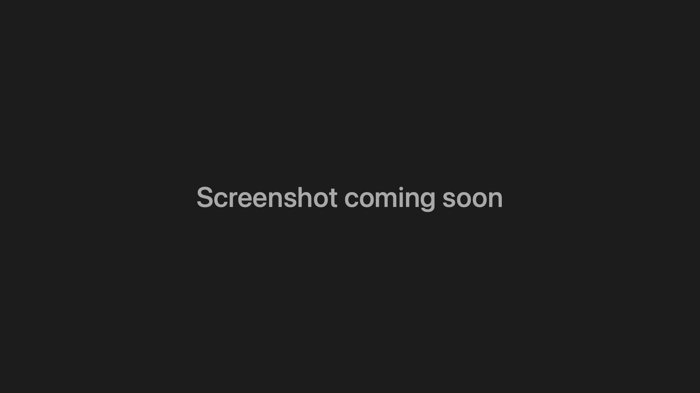

# Server Mode

**Turn your MacBook into a headless server with one click: plugged in, lid closed, never sleeping. Unplug it and it's a normal laptop again.**



## Why

I run AI coding agents on a MacBook that sits closed on a shelf and gets used over SSH, Screen Sharing and Tailscale. macOS really doesn't want to do that:

- Close the lid and the Mac goes to sleep, unless an external display is connected.
- `caffeinate` and Amphetamine-style apps keep it awake on battery too, so a laptop you take off the charger and put in a bag keeps running and gets hot.
- With no display attached, computer-use agents have no screen to capture, so you end up buying an HDMI dummy plug.
- A charger that's never unplugged keeps the battery at 100% and warm, which wears it out fastest.

Server Mode fixes all of that from the menu bar. On AC power the Mac stays awake with the lid closed. On battery it sleeps like any laptop. Plug it back in and server mode resumes.

## Features

- **One-click toggle.** The menu bar icon shows a laptop when server mode is off and an Xserve when it's on. Turning it on asks for your admin password once.
- **Power-aware.** A small LaunchDaemon blocks sleep only on AC power. Unplug with the lid closed and the Mac goes to sleep instead of cooking in your bag. The menu shows "paused on battery".
- **Virtual display.** Creates an invisible 1280×800, 1440×900 or 1920×1080 monitor, so a closed-lid Mac still has a screen for computer use and Screen Sharing. No HDMI dummy plug needed. **Auto** turns it on only while the lid is closed and no other monitor is connected.
- **Readiness checklist.** Checks power settings, a display for the closed lid, SSH, Screen Sharing, Tailscale, screen saver, App Nap in agent apps and FileVault. Click an item that isn't ready to fix it or open the right System Settings pane. The Tailscale item copies your Tailscale IP.
- **Battery Care.** Shows charge, health (and how it changed since the first recorded day), cycle count and battery temperature. Sets the macOS charge limit (80–95% or off), has "Charge to Full Now", and notifies you when the battery reaches 40 °C. Health is logged once a day to `~/Library/Application Support/ServerMode/battery-health.csv`.
- **Launch at Login**, so the virtual display comes back after a reboot.
- **A CLI too.** Everything privileged is done by one auditable bash script, `server-mode`, which you can also run on its own.

## How it works

The app is a small AppKit menu bar app (no Dock icon). It reads state by running `server-mode status` and runs `server-mode on` or `off` through `osascript ... with administrator privileges`.

**`server-mode on`** (needs root):

1. Saves your current AC power settings to `/Library/Application Support/ServerMode/pmset-ac.backup`.
2. Sets AC-only `pmset` values: `sleep 0`, `disksleep 0`, `displaysleep 0`, `standby 0`, `powernap 0`, `womp 1` (wake on network), `tcpkeepalive 1`. Battery settings are left alone.
3. Installs a root-owned copy of the script and the `com.sketchpiece.servermode.guard` LaunchDaemon in `/Library/LaunchDaemons/`.

**The guard daemon** runs every 10 seconds:

- On AC power it sets `pmset -a disablesleep 1`, which is what keeps a closed-lid Mac awake.
- On battery it sets `disablesleep 0`, and if the lid is already closed it runs `pmset sleepnow`.
- Plugging back in doesn't wake a sleeping Mac. Open the lid once and server mode resumes.

**`server-mode off`** removes the daemon and its script copy, sets `disablesleep 0` and restores the saved AC values.

Server Mode does not use `caffeinate` or power assertions. Everything goes through `pmset`, so the state survives the app quitting.

**The virtual display** uses the private `CGVirtualDisplay` API (the same one BetterDisplay and DeskPad use). **The charge limit** goes through the private `PowerUISmartChargeClient` class in PowerUI.framework, which needs no admin rights. Each method's signature is checked before it's called, so a macOS update can break the feature but can't crash the app. Battery temperature is read from the SMC key `TB0T`.

**Other settings it can change**, only when you click the matching checklist item: the screen saver idle time (`defaults -currentHost write com.apple.screensaver idleTime 0`) and `NSAppSleepDisabled` for the agent apps it knows about (T3 Code and Helm).

## Requirements

- A MacBook with Apple silicon (the build targets arm64).
- macOS 13 Ventura or later for the app. The charge limit needs macOS 26.4 or later.
- Xcode Command Line Tools (`xcode-select --install`) to build.
- An admin account to turn server mode on and off.

## Install

```bash
git clone https://github.com/SketchPiece/ServerMode.git
cd ServerMode
./build.sh --install          # builds build/ServerMode.app and copies it to ~/Applications
open ~/Applications/ServerMode.app
```

`./build.sh` without `--install` only builds into `build/`. The app is ad-hoc signed, which is fine for running it on your own Mac.

### Command line

```bash
./server-mode status   # mode, SSH, Screen Sharing, power, readiness checks, Tailscale
./server-mode on       # sudo: never sleep on AC power, even with the lid closed
./server-mode off      # sudo: restore normal sleep
```

## One-time setup for a headless Mac

1. **A display for the closed lid**: turn on the app's Virtual Display, or use an HDMI dummy plug.
2. **System Settings → General → Sharing**: turn on Remote Login and Screen Sharing.
3. **Tailscale**, to connect from outside your home network: `brew install --cask tailscale`. Use its own app, turn on "Launch at login", and disable key expiry for this machine in the admin console.
4. **Screen saver**: off (the checklist item turns it off). A locked screen doesn't stop running agents. It only matters for controlling the screen, and you can type the password over Screen Sharing.
5. **App Nap**: if you run agent apps, disable App Nap for them (the checklist does this for T3 Code and Helm, or run `defaults write <bundle id> NSAppSleepDisabled -bool YES`) and restart them. Otherwise macOS may throttle them once their windows are hidden.
6. **Battery**: set the charge limit to 80% in Battery Care.

### Battery Care on macOS 27

macOS 27 firmware removed the SMC keys that AlDente, batt and similar apps used to stop charging (`CHTE`, `CH0B`, `CH0C`, `BCLM`) and locked their replacements behind Apple entitlements. What's left is Apple's own charge limit (macOS 26.4+, Apple silicon, 80% to 100%), which is what Server Mode sets. The firmware keeps the limit across sleep and reboots, and macOS still charges to 100% now and then to recalibrate. Temperature comes from the SMC because macOS 27 no longer puts it in the I/O Registry.

### Rebooting with FileVault on

On Apple silicon with macOS 26 or later, FileVault can be unlocked over SSH, as long as Remote Login was on before the reboot:

```bash
ssh <user>@<laptop LAN IP>   # asks for the password, unlocks the disk, closes the connection
```

Then connect with Screen Sharing and log in: computer use needs an active GUI session.

Tailscale doesn't run until the disk is unlocked, so you have to connect from the same local network, or through a Tailscale subnet router on another always-on device on that network. For planned reboots, `sudo fdesetup authrestart` is simpler: the Mac comes back up without asking for the password.

## Uninstall

1. Turn server mode off from the menu (or run `./server-mode off`). This removes the LaunchDaemon and restores your power settings.
2. Turn off Launch at Login, quit the app and delete it:

```bash
rm -rf ~/Applications/ServerMode.app
sudo rm -rf "/Library/Application Support/ServerMode"   # normally already empty after "off"
rm -rf ~/Library/Application\ Support/ServerMode        # battery health log
defaults delete com.sketchpiece.servermode               # app preferences
```

If you uninstalled without turning server mode off first, check that `/Library/LaunchDaemons/com.sketchpiece.servermode.guard.plist` is gone and run `sudo pmset -a disablesleep 0`.

## Caveats

- It relies on private macOS APIs (`CGVirtualDisplay`, PowerUI) that can change in any update.
- A closed MacBook running on AC power gets warmer than an open one. Give it some air.

## License

[MIT](LICENSE) © 2026 Andrew Lubkin
